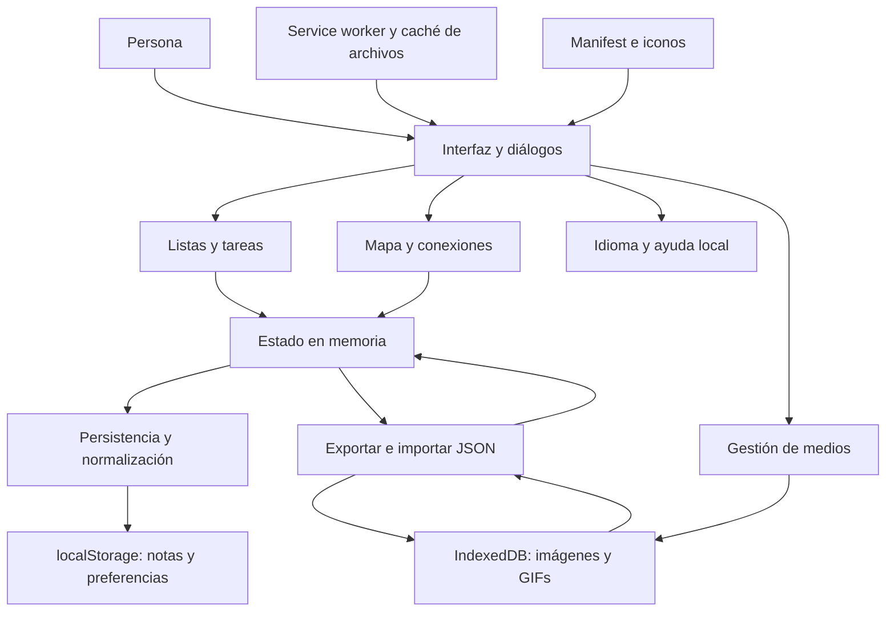
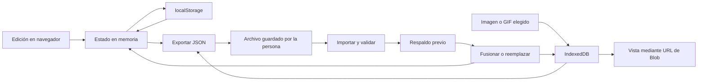
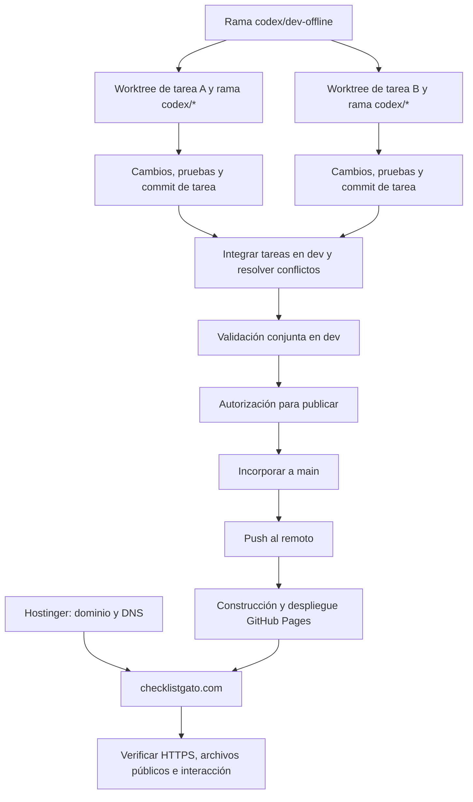

# Arquitectura y flujo de desarrollo de Checklist Gato

Documento de referencia para comprender y mantener el proyecto. Revisado el 2026-10-26. Distingue el comportamiento actual de las decisiones pendientes del [roadmap](ROADMAP.md).

## 1. Arquitectura actual

Checklist Gato es una PWA estática, sin backend propio, cuentas ni sincronización automática. Usa HTML, CSS y JavaScript nativos, sin dependencias externas de ejecución. GitHub Pages distribuye archivos; las notas se procesan y almacenan en el navegador.

| Responsabilidad | Implementación actual |
|---|---|
| Interfaz y accesibilidad | HTML, CSS, nodos DOM y diálogos en `index.html`; foco, teclado, anuncios y temas |
| Listas y tareas | Estado en memoria, normalización, edición, búsqueda, plantillas, progreso y fijado |
| Mapa y conexiones | Posiciones por lista, enlaces manuales, etiquetas compartidas, SVG y ordenamiento con Deshacer |
| Persistencia de notas | JSON en `localStorage`, clave `checklist-notas-v1`; preferencias de idioma, tema y vista en claves separadas |
| Medios | Imágenes/GIFs en IndexedDB, base `checklist-media`, almacén `images`; referencias `bgId` en notas, deduplicación y limpieza de huérfanos |
| Respaldos | Exportación/importación JSON, medios incluidos, validación, respaldo previo y fusión o reemplazo |
| Idiomas y ayuda | Diccionarios ES/EN y preguntas guiadas locales; el texto del usuario no se traduce |
| PIN visual actual | Verificador con sal, contenido sin cifrar y desbloqueo en memoria; no equivale a protección criptográfica |
| Uso offline | `sw.js`: red primero para documentos, con respaldo en caché; caché primero para recursos estáticos |
| Instalación y dominio | `manifest.json`, iconos y `CNAME` |
| Regresión | `tests/run.sh` y `tests/harness.html`, ejecutados con Python y Chrome headless |

Estas son responsabilidades lógicas dentro del archivo principal; no se presentan como módulos físicos separados ni se prescribe dividirlo ahora.

## 2. Datos y límites de almacenamiento

El estado en memoria representa el tablero activo. Las notas referencian sus medios por identificador; los binarios se guardan aparte. El JSON exportado reúne notas y medios para respaldo o traslado manual. Importar permite fusionar o reemplazar, con respaldo previo del estado actual.

- Cada origen y navegador tiene su almacenamiento propio. `localhost` y `https://checklistgato.com` no comparten listas, aunque ejecuten el mismo código.
- Actualizar código con Git no copia notas entre DEV y live. Para trasladar datos se usa Exportar/Importar conscientemente.
- Borrar datos del sitio puede borrar notas e imágenes. La caché del service worker contiene recursos de la aplicación y no sustituye un respaldo de las notas.
- No hay subida automática de notas a GitHub Pages ni a Hostinger. Los enlaces externos del sitio son servicios separados.
- El PIN publicado solo oculta contenido en la interfaz: almacenamiento y exportaciones conservan texto plano. La evolución a cifrado real está pendiente en CAT-20.

## 3. Entornos, Git y publicación

| Elemento | Función |
|---|---|
| `codex/dev-offline` | Rama de integración y desarrollo local; reúne las tareas antes de publicar |
| Worktree de tarea | Carpeta de trabajo independiente, normalmente con una rama `codex/*` creada desde dev |
| `main` | Rama principal y fuente del sitio publicado; recibe cambios validados y autorizados |
| GitHub | Repositorio remoto y servicio de construcción/despliegue de Pages |
| GitHub Pages | Sirve la aplicación estática desde la raíz de `main` |
| Hostinger | Gestión del dominio/DNS según la documentación del proyecto; no ejecuta el JavaScript de la aplicación ni guarda sus notas |
| `https://checklistgato.com/` | Dirección pública del sitio, con HTTPS obligatorio configurado en Pages |

Un worktree es una carpeta asociada a un estado de Git, no una rama por sí mismo. Comparte el repositorio y sus referencias con los otros worktrees, pero tiene archivos e índice propios. Puede estar en una rama o con HEAD separado. No existe una URL dev pública ni un servidor dev permanente configurado por el mero hecho de tener esa rama.

### Mecánica habitual

1. Actualizar dev desde la base acordada, revisar cambios locales y crear cada rama de tarea desde dev en un worktree separado.
2. Trabajar en un bloque acotado; ejecutar pruebas pertinentes, revisar el diff y actualizar documentación. Registrar el trabajo en commits de tarea antes de una integración por Git, dentro de la autorización correspondiente.
3. Integrar las ramas de tarea en dev. Resolver conflictos conservando el comportamiento acordado; ejecutar la suite sobre el conjunto integrado, no solo sobre cada tarea aislada.
4. Revisar y autorizar la publicación. Incorporar dev a main con avance rápido cuando sea posible; resolver cualquier divergencia explícitamente, sin sobrescribir trabajo ajeno ni forzar el remoto.
5. Subir main. Un commit local no publica; un push puede iniciar Pages, pero tampoco confirma que el despliegue terminó.
6. Esperar el resultado correcto de Pages para el commit esperado y comprobar el dominio, archivos servidos e interacción. Registrar los límites de las pruebas, como Android físico pendiente.
7. Conservar el worktree hasta verificar que su trabajo esté integrado. Limpiarlo o archivarlo solo cuando corresponda, sin perder cambios pendientes.

### Estado comprobado al cierre del 2026-10-24

- `main`, `codex/dev-offline` y la referencia local `origin/main` apuntan a `649a366403758bc777a4edfce61180b46e02e5d8`.
- En esta sesión se verificó el despliegue de ese commit en Pages y la igualdad de los archivos públicos principales con la versión local.
- Se conserva el worktree `pin-mapa`, basado en `c5b7915`, con HEAD separado, modificaciones locales y sin commit propio de tarea.
- La integración de ese trabajo se hizo copiando siete archivos, con respaldo y verificación SHA-256, hacia dev. Después se creó el commit integrado y main avanzó hasta él. No fue un merge de commits del worktree.
- El worktree conservado es una referencia de esa etapa: puede mostrar diferencias ya integradas. Antes de reutilizarlo hay que comparar su contenido con dev actual.
- Este cierre documental se guarda localmente, sin nuevo commit ni publicación. Las referencias anteriores son una instantánea, no una promesa de que sigan iguales en el futuro.

## 4. Diagramas, decisiones y comentarios mantenibles

Los diagramas Mermaid se guardan como texto junto al documento y evolucionan mediante los mismos diffs que el código. Su representación depende del visor Markdown; el código fuente del diagrama debe seguir siendo entendible por sí mismo.

Al cambiar almacenamiento, responsabilidades, flujo de datos o despliegue:

1. Actualizar el diagrama afectado y comprobar que sus flechas describan el comportamiento real.
2. Registrar fecha, decisión, motivo e impacto; enlazar el roadmap o incidencia correspondiente.
3. Revisar coherencia entre este documento, README, roadmap y changelog, distinguiendo lo implementado de lo pendiente.
4. Documentar comprobaciones realizadas y límites pendientes; no convertir propuestas en resultados verificados.

### Criterio para comentar el código

- Explicar la responsabilidad de un bloque y los motivos de una elección no evidente.
- Comentar invariantes: qué datos deben conservarse, cuándo una operación puede ejecutarse y qué estado invalida otra operación.
- En funciones delicadas, aclarar entradas, salidas, efectos sobre almacenamiento o DOM y comportamiento ante errores.
- Documentar casos como importación/fusión, gestión de cuota, captura de punteros, limpieza de recursos, foco y futuros límites del cifrado.
- Evitar narrar instrucciones evidentes o duplicar el código en comentarios. Actualizar o retirar comentarios que ya no describan la implementación.
- Nunca incluir PIN, contraseñas, notas reales ni credenciales en ejemplos, comentarios, diagramas o registros.

### Registro inicial de decisiones

| Fecha | Decisión | Motivo | Impacto / estado |
|---|---|---|---|
| 2026-10-24 | Mantener PWA estática con datos locales | Simplicidad, privacidad y funcionamiento offline | Arquitectura actual; no agregar backend por defecto |
| 2026-10-24 | Usar tareas en worktrees, integración en dev y publicación desde main | Separar trabajo, validación conjunta y entrega pública | Flujo habitual; la copia verificada anterior queda documentada como antecedente |
| 2026-10-24 | Evolucionar de PIN visual a cifrado real sin recuperación | El ocultamiento actual no cumple el objetivo de proteger el contenido | Pendiente en CAT-20; no se modifica hoy la aplicación |

### Integración local — 2026-10-25

- La rama `codex/dev-offline` usa el worktree `875e` e incorpora la documentación pendiente y la rama `codex/estilo-legibilidad` mediante merge local.
- `pin-mapa` ya estaba incorporado en la base `649a366`; conserva su estado histórico y no se reaplica.
- La integración incluye restablecer estilo, contraste de tarjetas y realce al completar tareas; caché `checklist-v14`. La validación conjunta se registra en el roadmap.
- Los snapshots del 2026-10-24 describen estados anteriores. `main` permanece en su commit anterior, con sus modificaciones documentales locales intactas. Sin push ni publicación.

### Publicación 2026-10-25

La candidata usa caché `checklist-v15`, sin cambios de esquema de datos ni infraestructura. El proceso autorizado es dev → main por fast-forward → push → Pages → comprobación del dominio y documentación servida. Los resultados finales se registran en el roadmap; no confundir preparación con despliegue verificado. Los documentos locales anteriores de main se conservan mediante copia externa y stash identificado.

### Resultado de publicación — 2026-10-25

El cambio funcional `99f44a3` se publicó con Pages completado correctamente y archivos del dominio iguales a los del repositorio. Se verificaron actualización de caché v13 → v15 con conservación de datos ficticios y recarga/edición offline pública. El cierre documental acompaña la misma versión funcional sin cambiar caché ni esquema. README, roadmap y changelog describen los resultados y límites actuales; las secciones anteriores conservan su contexto histórico. Todos los worktrees permanecen disponibles.

## Presentación local — 2026-10-26

La muestra de estilo reutiliza las variables de color, contraste y fondo de su tarjeta; muestra texto ficticio localizado, sin duplicar notas ni medios. La imagen usa la URL de Blob ya gestionada por la tarjeta. No incorpora persistencia ni modifica el esquema de respaldo.

Las transiciones usan Web Animations sobre opacidad durante 180 ms, solo desde creación manual/plantillas y cambio efectivo de vista. Respetan movimiento reducido, cancelan la transición anterior sobre el mismo elemento y no alteran coordenadas ni foco. Caché candidata v16, sin publicar.

## Publicación del bloque — 2026-10-26

El bloque de presentación y Mercado Pago está publicado desde dev → main con caché v16. Los registros locales anteriores se conservan como antecedentes. No cambian almacenamiento ni formato de respaldo. Pages completado y suite pública 50/50 en tiempo real normal; ver ROADMAP.md para evidencia, actualización de caché y límites de verificación. Los worktrees se conservaron y dev/main se sincronizan también con el cierre documental.

## CAT-27 — implementación local previa a la publicación (2026-10-27)

`imageVisibility` es un número entero por lista de 0 a 100, con valor predeterminado 40 para datos ausentes o inválidos. Se incluye en el JSON de esquema 2 y en la firma que detecta diferencias al fusionar. El archivo de respaldo anterior no se modifica; una versión anterior de la aplicación puede ignorar el nuevo ajuste de presentación.

La tarjeta y la muestra comparten `--image-shade` (100 menos la visibilidad). Las superficies de lectura sobre sus elementos contienen texto y controles sin depender de los colores de la imagen; se mantiene el color de primer plano apropiado al tema. La barra de color sigue usando `opacity`. Restablecer estilo elimina la imagen y vuelve `imageVisibility` a 40 sin modificar contenido o PIN.

Caché candidata v17, 52/52 pruebas en tiempo real normal y reducido; reloj virtual con timeout tras 50. Recarga offline y persistencia de imagen ficticia comprobadas en navegador aislado; ver límites de cobertura en ROADMAP.md. Sin publicación.

## CAT-27 publicado — 2026-10-27

El commit funcional `ea40c33` se integró de dev a main y Pages completó el despliegue de v17. La visibilidad de imagen modifica presentación y agrega `imageVisibility` al esquema 2; los respaldos anteriores se normalizan al 40 %. Pruebas, actualización local v16 → v17 y límites constan en ROADMAP.md. El cierre documental no modifica la aplicación ni la caché.

## Imagen completa y contraste automático publicados — 2026-10-27

V18 reemplaza las superficies y el velo de v17 por la imagen directa. `imageInkFor` analiza una muestra local de 48×48 píxeles y elige negro/blanco por cobertura de contraste, con contorno opuesto. Se comparte el resultado por URL de imagen y tema; la transparencia se compone con la base neutra del tema. Errores de decodificación usan tinta del tema; se descartan resultados obsoletos tras cambios de imagen/tema/PIN/renderizado.

Color/opacidad se muestran solo sin imagen; sus valores se conservan. `imageVisibility` mantiene normalización, exportación/importación y firma de fusión por compatibilidad, pero no tiene efecto visual ni control en pantalla. No hay cambios de esquema, dependencias ni envíos externos. La selección y el contorno no garantizan contraste en toda fotografía compleja. Evidencia de publicación y límites en ROADMAP.md.

## Rediseño editorial — 2026-10-30 (publicado y verificado)

La presentación se reorganiza sin tocar el modelo de datos. El header pasa a `.header-main` (marca, estado, CTA) y `.header-tools` (búsqueda y acciones); la fila de herramientas se desplaza horizontalmente en móvil y conserva los IDs y etiquetas de los controles existentes. El tablero usa un lienzo decorativo con `.board-wordmark` y `.board-decor`, ambos `aria-hidden` y `pointer-events:none`, por debajo de las tarjetas y del SVG de conexiones.

El footer se agrupa en `.footer-top` con tres `.footer-col`: Apoyar (Ko-fi, PayPal, Starlink), Transferencias (Prex y Mercado Pago) y Proyecto (feedback, ayuda, hoja de ruta). `.support-links` conserva exactamente los tres enlaces externos que valida la suite. La franja `.footer-legal` reúne el sello Open Source, la licencia MIT y la nota de colaboración voluntaria. `#footer-wordmark` se actualiza desde `applyLang` y muestra el nombre completo en mayúsculas.

Los tokens de color y las pilas tipográficas locales viven en `:root` y `:root[data-theme="dark"]`; los estilos nuevos se agregaron al final de la hoja existente para no reescribir reglas de tarjetas, imágenes, PIN o conexiones. No se modifican `PALETTE`, `imageInkFor`, el esquema 2, `localStorage` ni IndexedDB. `manifest.json` actualiza sus colores y `sw.js` usa la caché `checklist-v19`.

La suite pasa a 57 casos. `tests/run.sh` usa `tests/cdp-run.mjs` (Node 24) para esperar el `DONE` real del harness y evitar falsos negativos de decodificación de imágenes del reloj virtual; si Node no está disponible, conserva el ejecutor anterior con `--virtual-time-budget`. Resultado local: 57/57 PASS.

La publicación siguió `codex/diseno-editorial` → `codex/dev-offline` → `main` por fast-forward, con commit funcional `a5f5def3f963102bd8a65d6dd8e804f38c65d201` y [Pages 41112613399](https://github.com/MartnMartnez14/checklist/actions/runs/41112613399). El harness público aprobó 57/57; se verificaron la caché `checklist-v19`, el manifest, las capturas 1440/390 px en ambos temas y una recarga offline con `navigator.onLine === false`. Sin cambios de esquema, force push ni validación en Android físico, Safari o lector de pantalla.
